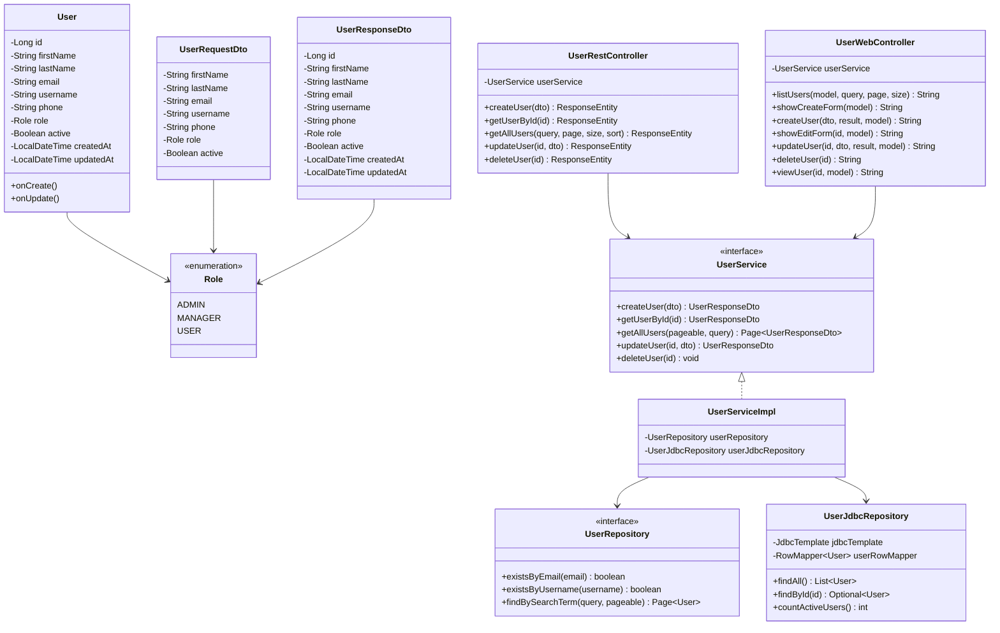
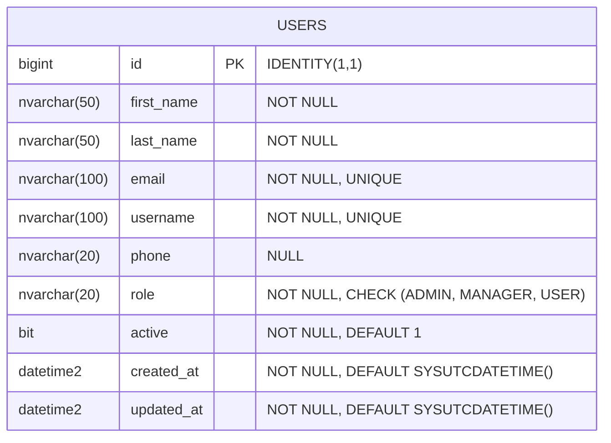

# Enterprise User Management System

A production-grade full-stack User Management System built with **Spring Boot 3.3.5**, **Java 21 LTS**, **Microsoft SQL Server 2022**, **Spring Data JPA**, **Spring JdbcTemplate**, **Thymeleaf**, and **Bootstrap 5**.

---

## 📋 Table of Contents
- [Architecture Overview](#architecture-overview)
- [Class Diagram](#class-diagram)
- [Entity-Relationship (ER) Diagram](#entity-relationship-er-diagram)
- [Tech Stack](#tech-stack)
- [Key Features](#key-features)
- [Project Setup & Installation](#project-setup--installation)
- [REST API Endpoints](#rest-api-endpoints)
- [Time Estimation vs. Actual Tracking](#time-estimation-vs-actual-tracking)
- [Conventional Commit Log](#conventional-commit-log)

---

## 🏛 Architecture Overview

The application follows a clean **N-tier layered enterprise architecture**:
- **Presentation Layer**: 
  - `UserRestController`: REST API with JSON responses, pagination, sorting, and validation.
  - `UserWebController`: Thymeleaf server-side rendered UI with Bootstrap 5.
- **Service Layer**:
  - `UserService` & `UserServiceImpl`: Encapsulates business logic, duplicate email/username validation, and DTO conversion.
- **Data Access Layer**:
  - `UserRepository`: Spring Data JPA repository for type-safe CRUD operations, pagination, and query derivation.
  - `UserJdbcRepository`: Spring `JdbcTemplate` repository for direct, optimized SQL operations and custom queries.
- **Cross-Cutting Concerns**:
  - `GlobalExceptionHandler` with `@RestControllerAdvice` and standard error payloads.

---

## 📐 Class Diagram



---

## 🗄 Entity-Relationship (ER) Diagram



---

## 💻 Tech Stack

| Component | Technology | Version |
|-----------|-----------|---------|
| **Language** | Java LTS | 21 |
| **Framework** | Spring Boot | 3.3.5 |
| **ORM / Data Access** | Spring Data JPA (Hibernate 6) & Spring JDBC | 3.3.5 |
| **Database** | Microsoft SQL Server Developer Edition | 2022 |
| **JDBC Driver** | mssql-jdbc | 12.6.3.jre11 |
| **Templating** | Thymeleaf + Bootstrap | 5.3.3 |
| **Testing** | JUnit 5, Mockito, AssertJ, Spring Boot Test | Latest |
| **Build Tool** | Apache Maven Wrapper (`mvnw`) | 3.9.x |

---

## 🚀 Project Setup & Installation

### 1. Prerequisites
- **JDK 21 LTS** installed with `JAVA_HOME` configured.
- **MS SQL Server 2022** running on `localhost:1433` with TCP/IP enabled.

### 2. Database Setup
Execute `schema.sql` located at the root of the project in SQL Server Management Studio (SSMS) or Azure Data Studio:
```sql
create database usermanagement_db;
go
use usermanagement_db;
go
-- Run the DDL statements in schema.sql
```

### 3. Application Configuration
Verify `src/main/resources/application.properties`:
```properties
spring.datasource.url=jdbc:sqlserver://localhost:1433;databaseName=usermanagement_db;encrypt=true;trustServerCertificate=true;
spring.datasource.username=sa
spring.datasource.password=YourSecurePassword
spring.jpa.hibernate.ddl-auto=validate
```

### 4. Build and Run
```powershell
# Run unit & integration tests
.\mvnw.cmd test

# Start the application
.\mvnw.cmd spring-boot:run
```
- Web Application: [http://localhost:8080/users](http://localhost:8080/users)
- REST API Base: [http://localhost:8080/api/users](http://localhost:8080/api/users)

---

## 🌐 REST API Endpoints

| Method | Endpoint | Description |
|--------|---------|-------------|
| `GET` | `/api/users` | List users with pagination (`page`, `size`, `sort`) and keyword search (`search`) |
| `GET` | `/api/users/{id}` | Retrieve single user by ID |
| `POST` | `/api/users` | Create new user (validates unique email & username) |
| `PUT` | `/api/users/{id}` | Update existing user details |
| `DELETE`| `/api/users/{id}` | Delete user by ID |

*Sample requests can be tested directly in VS Code using `requests.http`.*

---

## ⏱ Time Estimation vs. Actual Tracking

| Phase | Task Description | Estimated (hrs) | Actual (hrs) | Variance |
|-------|------------------|-----------------|--------------|----------|
| **Phase 1** | Project Bootstrap, Maven dependencies, Java 21 setup | 1.0 | 1.2 | +0.2 hrs |
| **Phase 2** | MS SQL Server setup, TCP/IP config, `schema.sql` DDL | 1.5 | 2.0 | +0.5 hrs |
| **Phase 3** | Domain Models, Role Enum, Request/Response DTOs & Validation | 1.0 | 1.0 | 0.0 hrs |
| **Phase 4** | Spring Data JPA Repository & Spring JdbcTemplate Repository | 1.5 | 1.2 | -0.3 hrs |
| **Phase 5** | Service Layer, Pagination, Filtering & Business Rules | 2.0 | 1.8 | -0.2 hrs |
| **Phase 6** | Custom Exceptions & `@RestControllerAdvice` Global Handler | 1.0 | 0.8 | -0.2 hrs |
| **Phase 7** | REST API Controllers with Pagination & Sorting | 1.5 | 1.5 | 0.0 hrs |
| **Phase 8** | Thymeleaf UI, Bootstrap 5 Templates, Search & Modals | 2.5 | 2.2 | -0.3 hrs |
| **Phase 9** | Unit Tests, Service Mock Tests & Integration Tests | 1.5 | 1.2 | -0.3 hrs |
| **Phase 10**| Documentation, `requests.http`, Architecture diagrams & README | 1.5 | 1.1 | -0.4 hrs |
| **Total** | Full-Stack Enterprise User Management System | **15.0 hrs** | **14.0 hrs** | **-1.0 hrs** |

---

## 📜 Conventional Commit Log

1. `feat: initial project bootstrap with Spring Boot 3 and dependencies`
2. `feat: configure MS SQL Server connection and add schema.sql DDL script`
3. `feat: add user entity, role enum, and request/response DTOs with validation`
4. `feat: implement Spring Data JPA repository and JdbcTemplate repository`
5. `feat: implement user service with pagination, search, and business validation`
6. `feat: add custom exceptions and global exception handler (@RestControllerAdvice)`
7. `feat: implement REST API controllers with pagination and sorting`
8. `feat: implement Thymeleaf web UI with Bootstrap 5 and delete confirmation modal`
9. `test: add unit tests for user service and controller mock tests`
10. `docs: add requests.http, architecture diagrams, and comprehensive README.md`

---
*Author: Imeth Mendis*
